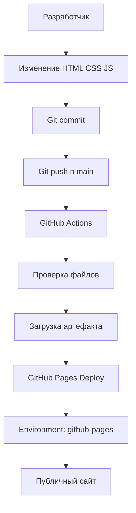

# 🚀 DevSpace — статический сайт с CI/CD


**DevSpace** — многостраничный статический сайт о программировании и современных технологиях. Проект создан в рамках индивидуального задания по DevOps и демонстрирует автоматическую публикацию сайта через GitHub Actions и GitHub Pages.

## 🌐 Ссылки проекта

- **Сайт:** https://gnikita777fool-pixel.github.io/project/
- **Репозиторий:** https://github.com/gnikita777fool-pixel/project
- **Deployments:** https://github.com/gnikita777fool-pixel/project/deployments
- **Environments:** https://github.com/gnikita777fool-pixel/project/settings/environments
- **GitHub Actions:** https://github.com/gnikita777fool-pixel/project/actions

## ✨ Возможности

- Пять взаимосвязанных HTML-страниц.
- Адаптивный интерфейс для компьютеров и мобильных устройств.
- Современный тёмный дизайн с градиентами.
- CSS-переходы и JavaScript-анимации.
- Демонстрационная форма обратной связи.
- Автоматическая публикация при push в ветку `main`.
- История успешных деплоев в GitHub.

## 🛠 Используемые технологии

- **HTML5** — структура страниц.
- **CSS3** — оформление, адаптивность и анимации.
- **JavaScript** — интерактивность.
- **Git** — контроль версий.
- **GitHub** — хранение исходного кода.
- **GitHub Actions** — автоматизация CI/CD.
- **GitHub Pages** — публикация сайта.

## 📄 Страницы сайта

| Файл | Описание |
|---|---|
| `index.html` | Главная страница |
| `about.html` | О проекте |
| `courses.html` | Обучающие материалы |
| `projects.html` | Примеры проектов |
| `contacts.html` | Демонстрационная форма |

## 📂 Структура проекта

```text
hello-pages/
├── .github/
│   └── workflows/
│       └── deploy.yml
├── css/
│   └── style.css
├── js/
│   └── script.js
├── index.html
├── about.html
├── courses.html
├── projects.html
├── contacts.html
└── README.md
```

## 🔀 Архитектура проекта



## ⚙️ Как работает CI/CD

1. Разработчик изменяет исходные файлы сайта.
2. Изменения фиксируются командой `git commit`.
3. Команда `git push origin main` отправляет изменения на GitHub.
4. GitHub Actions запускает workflow `Deploy DevSpace to GitHub Pages`.
5. Workflow проверяет наличие необходимых файлов и формирует артефакт.
6. GitHub Pages публикует новую версию сайта.
7. Результат можно проверить во вкладках Actions и Deployments.

## 🚀 Локальный запуск

1. Клонировать репозиторий:

   ```bash
   git clone https://github.com/YOUR-USERNAME/hello-pages.git
   cd hello-pages
   ```

2. Открыть `index.html` в браузере или использовать расширение Live Server в Visual Studio Code.

3. Для публикации внести изменения и выполнить:

   ```bash
   git add .
   git commit -m "update: change website"
   git push origin main
   ```

## 📈 Результаты выполнения

- Создан статический сайт из пяти страниц.
- Настроен CI/CD workflow с GitHub Actions.
- Сайт опубликован на GitHub Pages.
- Настроено окружение `github-pages`.
- Выполнены три отдельных обновления сайта с коммитами и push.
- Проверена история публикаций в Deployments.

## 👨‍💻 Автор

Бакшилов Никита Михайлович

Учебный индивидуальный проект по CI/CD и GitHub Pages.

*DevSpace — учись, создавай, публикуй.*
